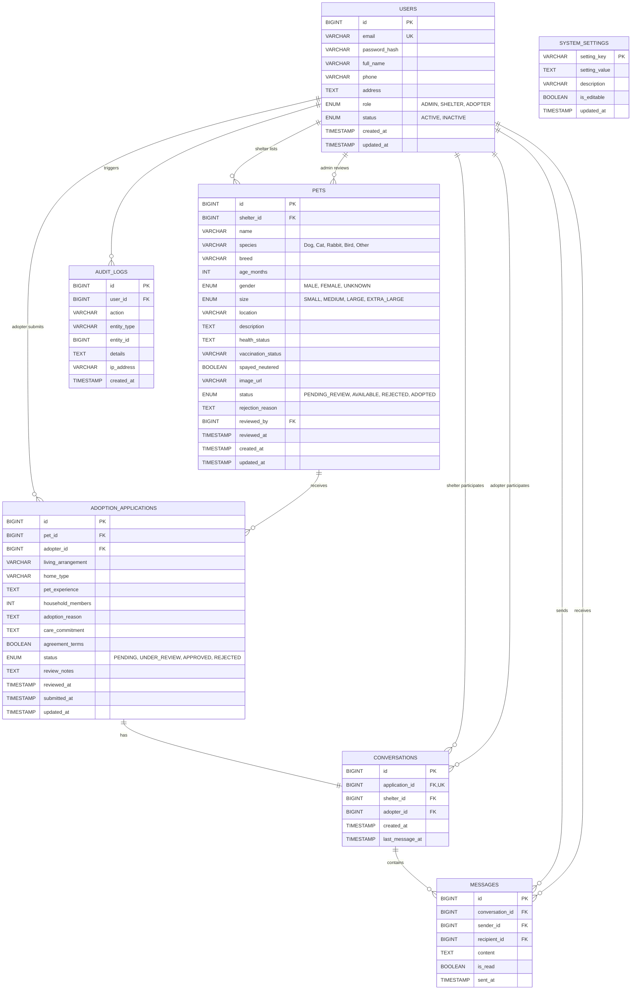

# Entity-Relationship (ER) Diagram
## Online Pet Adoption Platform

The following diagram illustrates the relational data model, cardinalities, primary keys (PK), and foreign keys (FK) implemented in `database/schema.sql`.

