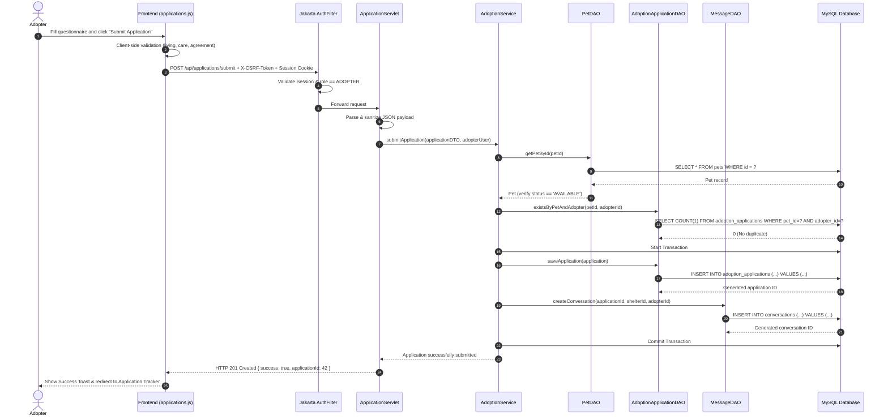

# System Diagrams: Use Case, Architecture & Sequence
## Online Pet Adoption Platform

### 1. Use Case Diagram
The following Mermaid diagram illustrates the actor boundaries and functional use cases for Public Guests, Adopters, Shelters, and System Administrators.

```mermaid
graph TD
    subgraph Actors
        G[Public Guest]
        A[Adopter]
        S[Shelter]
        ADM[Administrator]
    end

    subgraph "Public Services"
        UC1[Browse Available Pets]
        UC2[Filter & Search Pets]
        UC3[View Pet Details & Health]
        UC4[Register Account - Adopter/Shelter]
        UC5[Login / Logout]
    end

    subgraph "Adopter Capabilities"
        UC6[Submit Adoption Questionnaire]
        UC7[Track My Applications & Status]
        UC8[Chat with Shelter regarding Application]
        UC9[Manage Profile & Contact Details]
    end

    subgraph "Shelter Capabilities"
        UC10[List Rescued Pet with Photo & Health Info]
        UC11[Update / Resubmit Pet Details]
        UC12[Review Received Applications]
        UC13[Approve / Reject Application]
        UC14[Chat with Applicant]
        UC15[View Shelter Performance Metrics]
    end

    subgraph "Administrator Capabilities"
        UC16[Moderate Pending Pet Listings]
        UC17[Approve / Reject Listing with Reason]
        UC18[Manage Users - Activate/Deactivate]
        UC19[Configure System Settings]
        UC20[Inspect Real-time Platform Analytics]
        UC21[Review Audit Security Logs]
    end

    G --> UC1
    G --> UC2
    G --> UC3
    G --> UC4
    G --> UC5

    A --> UC1
    A --> UC3
    A --> UC6
    A --> UC7
    A --> UC8
    A --> UC9
    A --> UC5

    S --> UC10
    S --> UC11
    S --> UC12
    S --> UC13
    S --> UC14
    S --> UC15
    S --> UC5

    ADM --> UC16
    ADM --> UC17
    ADM --> UC18
    ADM --> UC19
    ADM --> UC20
    ADM --> UC21
    ADM --> UC5
```

---

### 2. Sequence Diagram: Submitting an Adoption Application
This diagram illustrates the end-to-end request lifecycle when an Adopter submits an application for a listed pet.

